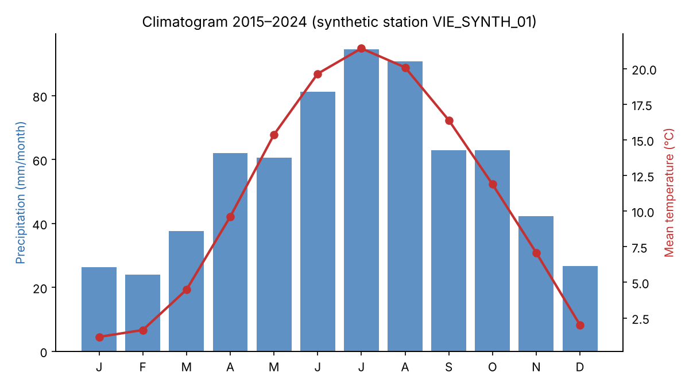
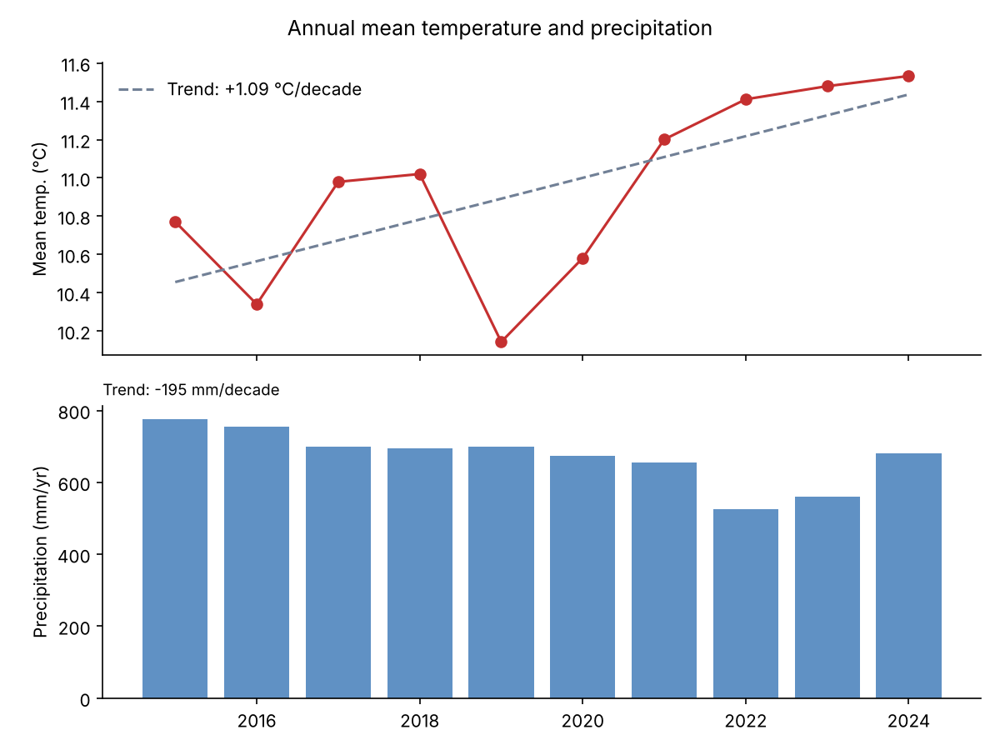
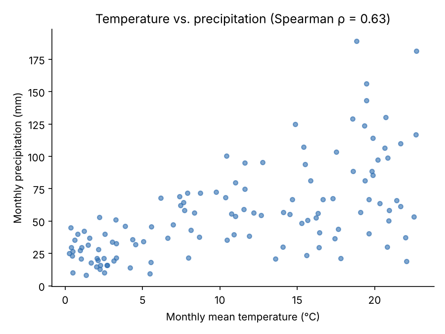

# Precipitation & Temperature Analysis

A small, reproducible analysis of daily precipitation and temperature data
(2015–2024) for a **synthetic** weather station modelled on Vienna's climate.

> ⚠️ The dataset is fictional and generated by `scripts/generate_data.py`.
> It is meant for demonstration purposes only.



## Questions

1. What does the seasonal cycle of temperature and precipitation look like?
2. Are there trends in annual mean temperature and annual precipitation?
3. How are monthly temperature and precipitation related?

## Key results

| Metric | Value |
|---|---|
| Mean annual temperature | 10.9 °C |
| Mean annual precipitation | 672 mm |
| Wet days (≥ 1 mm) per year | 93 |
| Wettest month | July |
| Spearman ρ (monthly T vs. P) | 0.63 |

Precipitation peaks in summer together with temperature (convective regime),
and the series shows a warming trend built into the synthetic data.

| Annual trends | Temperature vs. precipitation |
|---|---|
|  |  |

## Repository structure

```
├── data/
│   ├── raw/weather_daily.csv          # daily input data
│   └── processed/                     # monthly climatology, annual summary
├── figures/                           # generated plots
├── scripts/
│   ├── generate_data.py               # creates the synthetic dataset
│   └── analysis.py                    # cleaning, statistics, figures
├── requirements.txt
└── README.md
```

## Data

`data/raw/weather_daily.csv` – one row per day:

| Column | Description |
|---|---|
| `date` | Date (YYYY-MM-DD) |
| `station` | Station ID |
| `t_mean_c`, `t_min_c`, `t_max_c` | Daily mean / min / max temperature (°C) |
| `precip_mm` | Daily precipitation sum (mm) |

A few values are intentionally missing; temperature gaps (≤ 3 days) are
interpolated, missing precipitation is set to 0.

## Usage

```bash
pip install -r requirements.txt
python scripts/generate_data.py   # optional – data is already included
python scripts/analysis.py
```

## License

MIT
